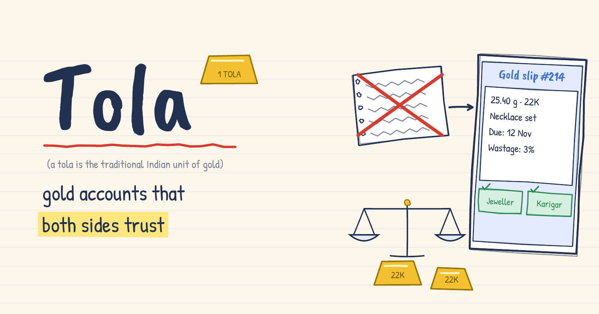
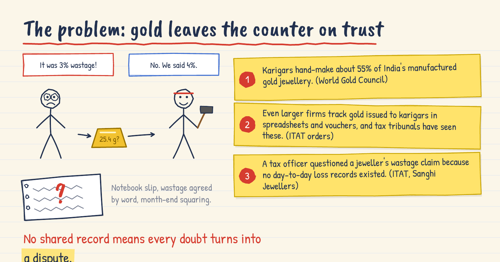
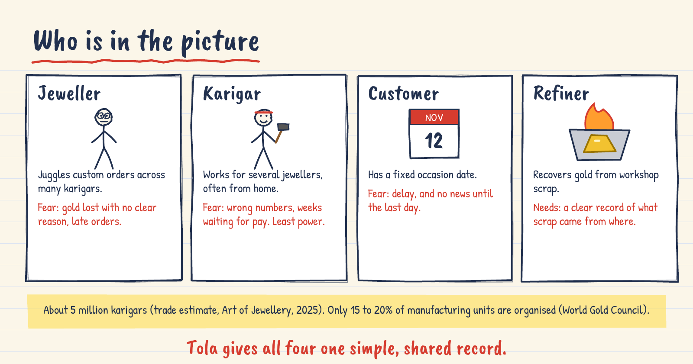
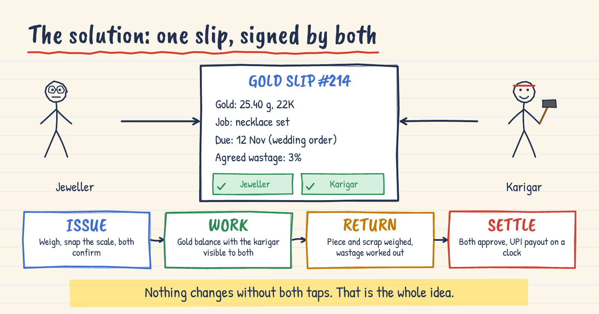
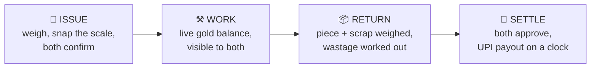
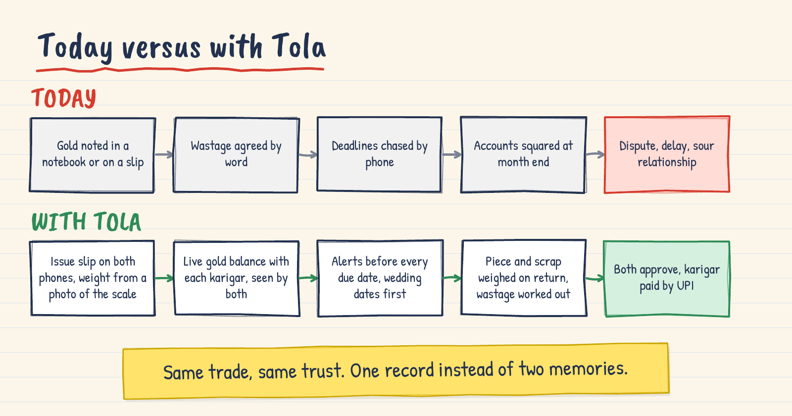
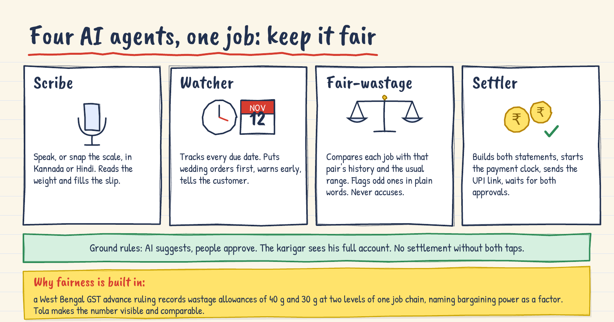
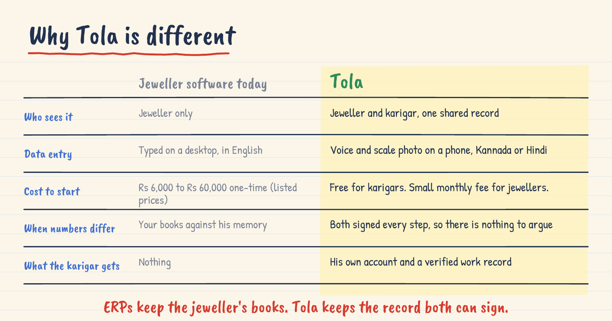
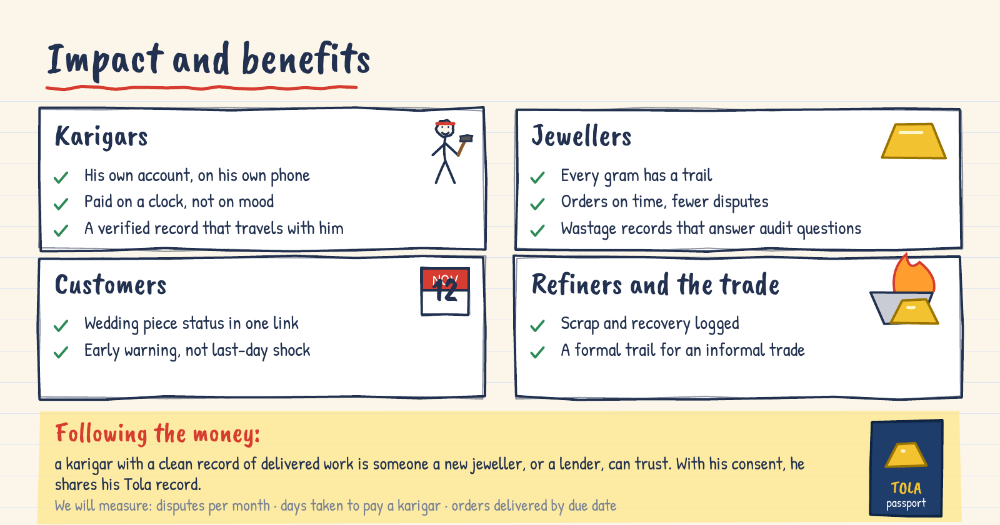
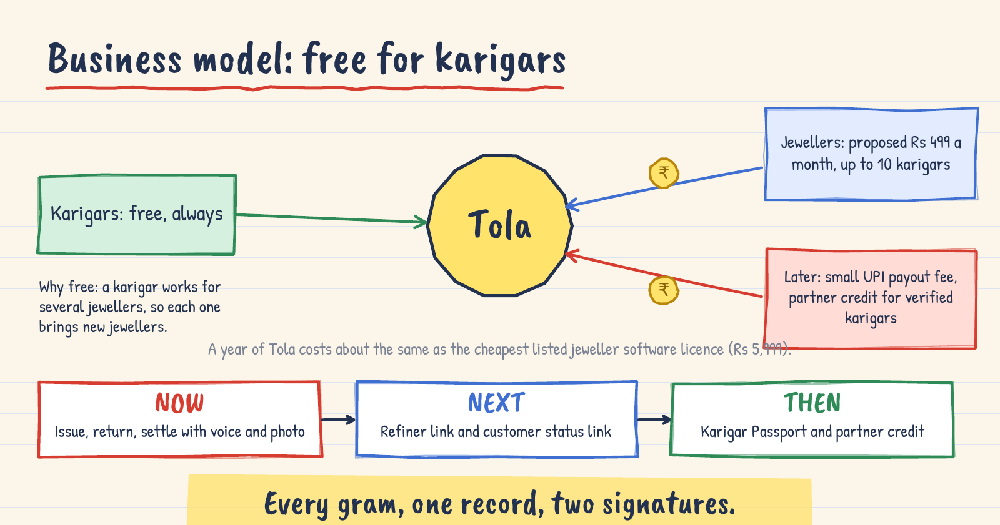

<div align="center">



# 🪙 Tola

### Gold accounts that both sides trust.
**Every gram. One record. Two signatures.**

A dual-signed digital ledger for gold job-work between **jewellers** and **karigars** (craftsmen).  
No more paper slips. No more *"I said 3%!" / "No, we said 4%!"*


[**✨ Features**](#-features) · [**🚀 Quick start**](#-quick-start) · [**🛡️ Security**](#️-security--trust) · [**🧱 Stack**](#-tech-stack) · [**🗺️ Roadmap**](#️-roadmap)

</div>

---

## 😤 Why Tola exists

In India's gold trade, jewellers hand raw gold to karigars for job-work. Today that runs on **notebook slips, verbal wastage deals, phone-call deadlines and month-end squaring**. With no shared record, every doubt becomes a dispute. Karigars (the least powerful side) wait weeks for pay, and jewellers lose gold with no trail.



> 🔨 Karigars hand-make about **55%** of India's manufactured gold jewellery, and only 15–20% of manufacturing units are organised *(World Gold Council)*. There are roughly **5 million** karigars *(trade estimate, Art of Jewellery, 2025)*.



**Tola gives all four one simple, shared record.**

---

## ✨ Features

### 📝 One slip, signed by both



### 🔐 The one rule: *"Nothing changes without both taps."*





### 🤖 Four AI agents, one job: keep it fair

> **AI suggests. People approve. The AI never changes a number on its own.**



| Agent | What it does |
|---|---|
| 🎙️ **Scribe** | Speak in Kannada / Hindi / English or snap the scale. Reads the weight and fills the slip. |
| 👁️ **Watcher** | Tracks due dates, puts wedding orders first, warns early, shares a customer status link. |
| ⚖️ **Fair-Wastage** | Compares each job with the pair's history and trade benchmarks using statistical anomaly detection. Flags outliers gently ("higher than usual"), **never accusingly**. |
| 💰 **Settler** | Builds both statements, starts the payment clock, generates the UPI deep link, waits for both approvals. |

### 🤝 Disputes, without the drama

- **Wastage counter-proposals.** Karigar disagrees? Counter-propose; the jeweller accepts or declines.
- **Dispute flag.** Either side can raise one. **Settlement is blocked** until resolved, and the accused party can't resolve it alone.
- **Payment clock.** Jeweller pays via UPI link/QR and enters the reference; the karigar confirms receipt with an OTP. *Paid on a clock, not on mood.*

### 🌐 Public links: no login, no leaks

| Link | For | Shows |
|---|---|---|
| `/status/[token]` 💍 | **Customer** | Order progress and ETA only. Strict whitelist: no weights, wastage or financials. |
| `/refiner/[token]` 🔥 | **Refiner** | Log recovered scrap gold (`ScrapLot`) with a clear trail of where it came from. |
| `/passport/[token]` 🪪 | **Karigar** (opt-in) | **Karigar Passport**: delivered jobs, on-time %, average wastage. Zero PII. A portable trust record. |

### 📱 Built for the real workshop

Low literacy, patchy signal, cheap phones, so:

- 🎤 Voice and photo entry instead of typing
- 📴 **Offline-first PWA**: actions queue in IndexedDB and sync when signal returns
- 🌏 Full **English / हिन्दी / ಕನ್ನಡ** (Noto Sans)
- ✏️ A hand-drawn **Sketch Notebook** design system that feels like the paper slip it replaces



---

## 🛡️ Security & trust

| | |
|---|---|
| ⛓️ **Tamper-evident ledger** | Append-only, SHA-256 hash-linked entries (`seq`, `prevHash`, `actor`, `proof`). Edit, reorder or delete a record and the chain breaks and is flagged instantly. |
| 🔑 **OTP signatures** | Issue, return approval and settlement need a 6-digit OTP: hash-only storage, 5-minute expiry, 3 attempts. |
| 🙈 **Strict data isolation** | PIN-based auth for jeweller and karigars. A karigar sees **only** their own slips, balances and ledger entries. |
| ✅ **Server-side validation** | Every API route validates strictly on the server. |

---

## 💡 Who wins



---

## 🧱 Tech stack

| Layer | Choice |
|---|---|
| Framework | Next.js 16 (App Router) + React 19 |
| Language | TypeScript |
| UI | Tailwind CSS 4, shadcn/ui, custom Sketch Notebook design system |
| Database | Prisma ORM + SQLite (switch to PostgreSQL for production) |
| Testing | Vitest: **182 passing tests** |
| Architecture | Full-stack Next.js, server-side API routes, offline-first PWA |

---

## 🚀 Quick start

**Requirements:** Node.js 20+ and npm.

```bash
# 1. Clone
git clone https://github.com/manishchandraraturi/tola.git
cd tola

# 2. Install (also runs `prisma generate`)
npm install

# 3. Configure the database
echo 'DATABASE_URL="file:./dev.db"' > .env

# 4. Create the SQLite database
npm run db:push

# 5. Run
npm run dev
```

Open **http://localhost:3000** 🎉

### 📜 Scripts

| Command | What it does |
|---|---|
| `npm run dev` | Start the dev server on port 3000 |
| `npm run build` | Production build with strict type checking |
| `npm start` | Serve the production build |
| `npm test` | Run all 182 Vitest tests |
| `npm run test:watch` | Tests in watch mode |
| `npm run lint` | ESLint |
| `npm run check:routes` | Route sanity check |
| `npm run db:push` · `db:generate` · `db:migrate` · `db:reset` | Prisma database tasks |

Deploying to Vercel or Render, or moving to PostgreSQL? See [`DEPLOYMENT.md`](./DEPLOYMENT.md).

---

## ✅ Quality

- 🧪 **182 tests**: ledger integrity (tampering, reordering, deletion), auth privacy, OTP expiry/reuse, payment flows, fair-wastage bands
- 🧹 **0 lint errors · 0 TypeScript errors**
- 📦 **Production build verified**, Prisma client generated via `postinstall`

---

## 🗂️ Project structure

```
src/
├─ app/api/            # auth, slips, ledger, agents, otp, payments
├─ lib/                # tola.ts (ledger + math), auth.ts, otp.ts, i18n.ts
└─ components/tola/    # dashboard, karigar-view, sketch UI
prisma/schema.prisma   # data models
tests/                 # Vitest suites
assets/                # README images
```

---

## 🧭 Honest scope

Tola is a working prototype, and it says so, both here and in the UI.

- 🧠 **Deterministic AI agents.** The four agents run as rule-based, local algorithms: zero hallucinations, zero API cost, fully offline. The architecture is ready to plug in LLMs (OpenAI, Anthropic, Lyzr) via environment variables.
- 🎭 **Demo adapters.** WhatsApp/SMS, UPI payouts and voice/photo AI are real interfaces running as **DEMO** adapters, visibly labelled in the UI.

---

## 🗺️ Roadmap



| NOW | NEXT | THEN |
|---|---|---|
| Issue, return, settle with voice and photo | Refiner link and customer status link | Karigar Passport and partner credit |

---

<div align="center">

### Same trade. Same trust. **One record instead of two memories.**

🪙 **Every gram, one record, two signatures.** 🪙

Built by [@manishchandraraturi](https://github.com/manishchandraraturi)  
⭐ Star the repo if Tola made you smile.

</div>
